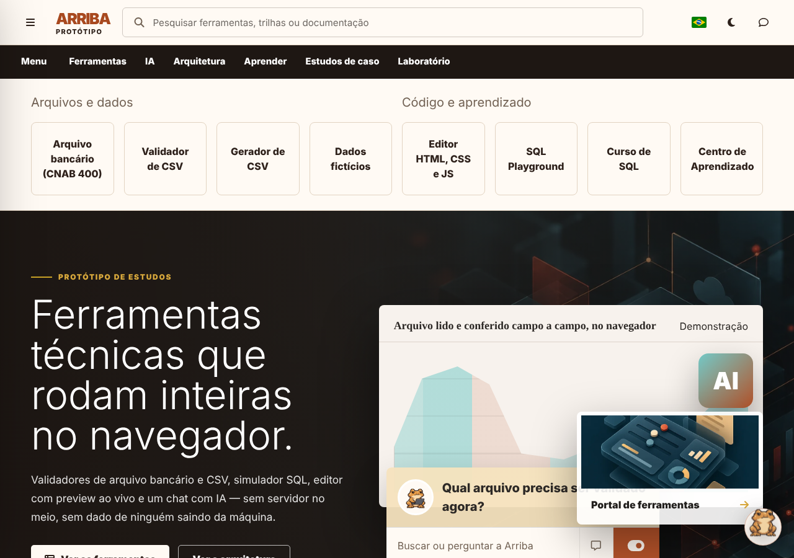
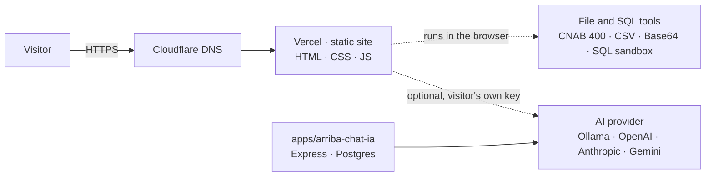

<div align="center">

# Arriba Platform

**A study prototype: browser-based technical tools, in one place.**

Validators for bank files (CNAB 400) and CSV, test-data generators, a SQL sandbox with
a course, a live-preview web editor and a multi-provider AI chat app.
Every tool on the site runs in the browser — no server in the middle, no data leaving the machine.

[**🔗 Live demo → arriba.jm.dev.br**](https://arriba.jm.dev.br/)

<br>


</div>

<div align="center">
  
</div>

---

## Why this exists

I work in IT support, and a lot of that job is repetitive, error-prone manual work:
reading fixed-width bank files, checking CSV imports line by line, generating test data,
writing the same SQL again. **Arriba Platform** turns each of those into a small,
self-service tool that runs in the browser.

It is also my portfolio, and it is a **study prototype**: the domain (debt-collection
files and data) is real, but every sample record is invented and no tool talks to a real
customer system.

## Highlights

- ⚡ **Client-side by design** — the file tools run entirely in the browser: no server cost,
  no cold start, and the file never leaves the machine.
- 🎨 **Own design system** — a warm, earthy palette defined as tokens in a single file, with a
  dark mode checked by an automated contrast audit (WCAG 2.1) on every page, in both themes.
- 🗂️ **Single source of truth** — navigation, search index and design tokens each live in
  exactly one file, so adding a tool or changing a color touches one place.
- 🏦 **Real file formats** — the CNAB 400 tool reads and generates bank files for three banks,
  field by field; the CSV validator follows RFC 4180 (quotes, escaped quotes, line breaks
  inside fields).
- 🤖 **AI chat app** — Node, Express and Postgres, multiple AI providers, a knowledge base with
  cited sources, and an audit trail.
- 🔒 **Security from the start** — user code runs in a sandboxed iframe, every CDN library is
  pinned with an SRI hash, and provider keys are encrypted at rest (AES-256-GCM).

## Tech stack

| Layer | Technology | Hosting |
|---|---|---|
| **Frontend** | Vanilla HTML/CSS/JavaScript + Bootstrap 5, own token-based design system | Vercel |
| **Apps backend** | Node.js + Express + Prisma (Postgres for the chat app, SQLite for the mail app), in `apps/` | not deployed yet |
| **DNS** | Cloudflare (`jm.dev.br`) | Cloudflare |

> No framework on the frontend by choice: the tools are small, must load instantly, and
> ship as static files. Complexity is added only where it earns its place.

## Architecture



The site's tools never touch a backend — they process files locally. A server only exists for
the apps in `apps/`, which need sessions, history and encrypted keys.

## Featured tools

| Tool | What it does |
|---|---|
| **Bank file validator (CNAB 400)** | Reads and generates the fixed-width file banks exchange with companies (three banks), field by field, and checks the trailer totals |
| **CSV validator** | Separates "is the file well-formed?" (RFC 4180) from "is the content right?" (per-column rules) |
| **CSV generator by layout** | Builds sample CSV files from a layout — the same source the validator uses |
| **Test-data generator** | Fictitious names, valid CPF/CNPJ, phones and addresses |
| **SQL Playground + SQL course** | An in-browser database with schema explorer, history and saved queries, plus lessons with exercises graded on the spot |
| **Visual SQL query builder** | Builds T-SQL reports by picking tables and filters |
| **Live web editor** | HTML, CSS and JS with live preview in a sandboxed iframe |
| **Converters** | CSV→JSON, Base64→PDF, decoder (Base64, URL, JWT, hex), hash calculator |
| **AI chat app** (`apps/arriba-chat-ia`) | Multi-provider chat with streaming, admin panel, audit log and a knowledge base built from this repo's docs |
| **Mail templates app** (`apps/comunicados`) | Letter templates with variables and batched e-mail sending, with unsubscribe handling |

## Run locally

No build step is required for the site.

```bash
git clone https://github.com/jonathanmesquita/arriba_platform.git
cd arriba_platform
npx serve .          # or VS Code "Live Server"
```

Each app in `apps/` has its own README with setup steps (database, environment variables,
first admin user).

## Project structure

```
arriba_platform/
├─ index.html                 # Home: menu, search and tool shortcuts
├─ tools/
│  ├─ dados/                  # CSV validator, converters, decoder, web editor
│  └─ cobranca/               # CNAB 400, CSV generator, test data, SQL tools
├─ pages/                     # about, case studies, guides, lab
├─ apps/                      # standalone apps with their own backend (not deployed with the site)
├─ assets/
│  ├─ css/tokens.css          # design tokens — the single source of colors
│  ├─ js/navigation-v2.js     # menu + search index, in one place
│  └─ data/                   # chat knowledge base, SQL sandbox schema
├─ scripts/                   # changelog, commit hook, contrast audit
└─ tasks/                     # the work queue: backlog, bugs, pending decisions
```

## Roadmap

- [ ] Automated tests for the site's pure logic (CSV parser, CNAB engine, validation rules)
- [ ] Contrast audit for opened states (chat, menu, modals), not only the page on load
- [ ] Deploy the chat app (managed Postgres, secrets outside the repo)
- [ ] Sign-in with Microsoft (Azure AD) on the backend
- [ ] Bilingual content (PT/EN) and a `Ctrl/Cmd + K` command palette

## About the author

**Jonathan Mesquita** — IT Support Analyst transitioning into Full-Stack development.
I build tools that solve real operational problems, and I treat my non-traditional
background (technical support + hospitality tech) as an edge, not a gap.

> *"Aprender é hackear a si mesmo."*

- 🌐 Portfolio: [arriba.jm.dev.br](https://arriba.jm.dev.br/)
- 💻 GitHub: [github.com/jonathanmesquita](https://github.com/jonathanmesquita)

## License

Released under the [MIT License](LICENSE).

---

<div align="center">
<sub>Built with intention — minimal dependencies, real content, honest engineering.</sub>
</div>
