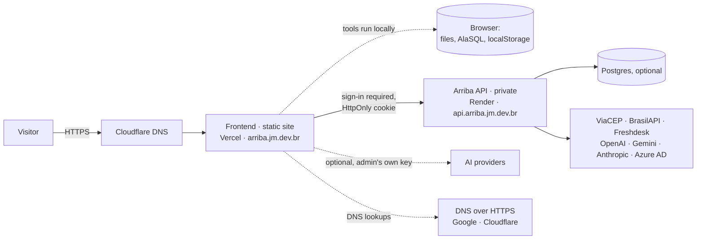

# Arriba Platform Architecture

> Describes what exists and runs today. Anything planned is in
> [Future Architecture](#future-architecture) and marked **FUTURE / NOT IMPLEMENTED**.
> Design decisions and their rejected alternatives are recorded as ADRs in
> [`.claude/memory/decisions.md`](../.claude/memory/decisions.md).

## Overview

Arriba Platform is a study project built from problems met in IT support: a bank file
rejected without saying which field is wrong, a CSV that "looks fine" but breaks an import,
a SQL query nobody can safely try. Each problem became a small tool.

Most of the platform is a **static site whose tools run entirely in the browser**: files are
parsed and generated on the visitor's machine and never uploaded. A private API exists only
for the few features that need a server (sign-in, public-data lookups, server-side AI and an
admin dashboard).

## System Context

The two applications in `apps/` are **not deployed** and are not part of this diagram's
production path (see [Applications](#applications)).

## Frontend

| | |
|---|---|
| Repository | `arriba_platform` (public) |
| Deployment | Vercel, deploy on push to `main` |
| Domain | `arriba.jm.dev.br` |
| Stack | HTML, CSS, JavaScript (native ES modules), Bootstrap 5 from CDN with SRI hashes. No framework, no build step (ADR-001) |

**Static tools.** 18 tool folders under `tools/` (bank files, CSV, data generators, code,
SQL, network). Each tool is an HTML page plus its own script; shared code lives in
`assets/js/` (navigation and search, design tokens, fake-data generators, SQL sandbox,
API client).

**Processing in the browser (ADR-003).** CNAB, CSV, Base64/PDF and JSON are read and
generated client-side. The SQL Playground and course run on AlaSQL against a fictional
schema (`assets/data/sandbox-schema.js`). History, saved queries and course progress are kept
in `localStorage`. The web editor runs user code in an `<iframe>` sandbox without
`allow-same-origin` (ADR-008). The DNS tool queries public DNS-over-HTTPS resolvers directly.

**Admin pages.** `pages/admin/configurar-chat.html` and `pages/admin/painel-api.html` are out
of the menu and `noindex`. They only show their content after the Arriba API confirms a
session with the `admin` role. All API calls go through one module,
`assets/js/arriba-api.js`.

**Site chat.** Answers from a local knowledge base (`assets/data/base-conhecimento.js`) in the
browser. An administrator can configure an AI provider with their own key, stored in their
own browser. A server-side AI path exists in the API but is **off by default** on both sides.

**Unpublished apps.** `apps/` holds two full-stack applications with their own build and
dependencies. `.vercelignore` keeps them out of the static deploy.

## Backend

| | |
|---|---|
| Repository | `arriba-api` (**private**) |
| Deployment | Render |
| Domain | `api.arriba.jm.dev.br` |
| Stack | Node.js, Express, `jose` (JWT), `pg`, OpenAI and Anthropic SDKs, Gemini REST |

Responsibilities, by route group:

| Routes | What they do |
|---|---|
| `GET /`, `GET /healthz` | Liveness |
| `/auth/*` | Password sign-in returning an `HttpOnly` cookie, session status, sign-out; Microsoft (Azure AD) sign-in validation |
| `/v1/validar/:tipo` | Server-side validation of data |
| `/v1/consultar/cep`, `/cnpj`, `/bancos` | Lookups against public APIs (ViaCEP, BrasilAPI) |
| `/v1/painel/resumo`, `/v1/painel/chamadas` | Admin dashboard: call volume, latency, errors. Stores the **route template**, never the value that was looked up |
| `/v1/ia/status`, `/v1/ia/conversar` | Server-side AI (provider key in an environment variable) |
| `/publico/chat` | AI for the public site chat. Off by default, rate-limited per minute and per day |
| `/freshdesk/*`, `/support/*` | Help-desk integration (tickets, knowledge base, analysis) — see [Repository Boundaries](#repository-boundaries) |

Everything except `/`, `/healthz` and `/auth/*` requires an identity (cookie or API key).
The API has its own CI workflow with tests and a disposable Postgres.

## Data

| Store | Where | Used for | Status |
|---|---|---|---|
| Postgres (optional) | Arriba API, `DATABASE_URL` | Dashboard call history (30-day retention). Without it the API keeps the last calls in memory and says so on the dashboard | Production, optional |
| Postgres | `apps/arriba-chat-ia` (Prisma 7, `pg` adapter) | Users, conversations, provider settings with encrypted keys, imported knowledge base with Portuguese full-text search | Not deployed |
| SQLite | `apps/comunicados` (Prisma 7, `better-sqlite3`) | Letter templates, mailing history, unsubscribe list, encrypted SMTP settings | Local tool |
| AlaSQL | Browser | SQL Playground and SQL course, fictional data only | Production |
| `localStorage` | Browser | Preferences, SQL history, course progress, the admin's own AI key | Production |

Credentials are never stored in this repository; every app ships a `.env.example` with
variable names only.

## Applications

### Arriba Chat IA — `apps/arriba-chat-ia`

- **Status:** not deployed.
- **Stack:** React + Vite (web), Express + TypeScript (server), Prisma 7 + Postgres,
  `docker-compose.yml` for a local database.
- **Responsibilities:** multi-provider chat (streaming), administration and audit, provider
  keys encrypted at rest (AES-256-GCM), and a knowledge base imported from this repository's
  own documentation, cited in answers.

### Comunicados — `apps/comunicados`

- **Status:** local/internal tool, run on the operator's machine.
- **Stack:** React + Vite (web), Express + TypeScript (server), Prisma 7 + SQLite,
  Nodemailer.
- **Responsibilities:** letter templates with declared variables (escaped in HTML), batch
  e-mail with recipients in BCC, unsubscribe check on every send, SMTP password encrypted and
  never returned over HTTP, SMTP errors masked before being stored. A test mode writes `.eml`
  files instead of sending.

Both apps' server test suites run in CI (one job per app, no database or secrets needed).

## CNAB

Bank files are fixed-width text. The difference between banks is a table, not an algorithm
(ADR-005), so each format has **one engine plus one declaration file per bank**. Positions
are taken from the bank manuals (1-indexed, inclusive). A field that could not be confirmed in
a reliable source is flagged `naoConfirmado`, never guessed.

### CNAB 400 — `tools/cobranca/cnab400/`

- `engine.js`: generic reader (`parseArquivo`) and generator (`gerarArquivo`). It does not
  assume 400 positions (`tamanhoRegistro`), and it checks the trailer totals against what was read.
- `validacao.js`: content validation on read and before generating; errors block the download,
  and the generated file is re-checked with the read rules.
- Banks registered in `banks/registry.js`:

| Bank | Code | Directions |
|---|---|---|
| Bradesco | 237 | remittance and return |
| Itaú | 341 | remittance and return |
| BMP | 274 | remittance and return |
| Inter | 077 | remittance and return |
| Paulista (FIDC) | 611 | remittance only — **CNAB 444**, see below |

### CNAB 444 — `banks/paulista.js`

The same CNAB 400 engine with `tamanhoRegistro: 444`. Remittance only; the UI disables the
direction that does not exist.

### CNAB 240 — `tools/cobranca/cnab240/`

- `validacao240.js`: structure valid for any bank (line length, batches, record types,
  sequence numbers, segments, trailer totals).
- `layouts/`: bank layouts, where the segment letter selects the field list.

| Layout | Bank | Scope |
|---|---|---|
| `santander.js` + `santander-regras.js` | Santander (033) — collection | Segments P, Q, R, S, Y (remittance) and T, U, Y (return); generator builds P+Q and T+U |
| `inter-pagamentos.js` | Inter (077) — payments | Five batch types (TED, Pix, boletos, Pix QR Code, taxes), chosen by the batch header; generator builds one batch type at a time |

- `gerar240.js`: generator that computes batch numbers, sequence numbers and trailer totals.

**How the layouts are proven without production files:** a test checks that each record
covers every position with no gap or overlap; the check-digit examples from the manuals pass;
and a generate → read round trip produces no warning. Known limits are declared on screen, in
the layout headers and in `tasks/backlog.md`.

Reference page: `pages/docs/padroes-cnab.html`. Tests: `scripts/tests/cnab*.test.mjs`.

## External Integrations

| Integration | Called from | Purpose |
|---|---|---|
| ViaCEP | Arriba API | Postcode lookup |
| BrasilAPI | Arriba API | CNPJ and bank lookups, and postcode fallback |
| Freshdesk | Arriba API | Help-desk tickets and knowledge base |
| OpenAI, Gemini, Anthropic | Arriba API (server key); browser (admin's own key); `apps/arriba-chat-ia` | AI answers |
| Azure AD | Arriba API | Microsoft sign-in validation |
| DNS over HTTPS (Google, Cloudflare) | Browser (`tools/rede/dns/`) | DNS and e-mail record checks |

## Deployment

| Component | Host | Trigger |
|---|---|---|
| Frontend | Vercel | Push to `main` of `arriba_platform` |
| API | Render | Configured in Render (outside this repository) |
| DNS | Cloudflare | `jm.dev.br` zone (outside this repository) |

The Vercel project follows the GitHub repository by its internal ID, not by its name. When
the old repository was renamed in November 2026, production kept deploying the renamed one
until the link was redone. A healthy deploy shows a commit from this repository's `main` as
its source.

## Security Boundaries

- **Local processing:** file and SQL tools never send data to a server.
- **Secrets outside the repository:** the static site is public by definition, so it holds no
  secret. Server keys live in Render environment variables; apps read `.env` files that are
  not committed. A browser-side AI key belongs to whoever typed it.
- **CORS:** the API accepts browser calls only from `arriba.jm.dev.br`. Vercel preview URLs
  are deliberately excluded.
- **Authentication:** `POST /auth/login` returns an `HttpOnly` cookie that JavaScript cannot
  read. It is sent to the API because both hosts are the same *site* (`dev.br` is a public
  suffix). A pasted API key stays in a module variable and disappears on reload. Sign-in is
  rate-limited. `?api=` overrides are accepted only for `http://localhost`.
- **Third-party content** (API responses, DNS TXT records, CSV cells) is written with
  `textContent`, never `innerHTML`.
- **Unpublished apps** are excluded from the static deploy by `.vercelignore`.
- **Public vs private content:** this repository contains engineering only. Operational
  material from an employer was removed in October 2026 (see below).

## Repository Boundaries

| Repository | Visibility | Role |
|---|---|---|
| `arriba_platform` | Public | Frontend, tools, the two apps, documentation. Its history starts on 13 Nov 2026 |
| `arriba-api` | Private | Backend. It is private because, besides generic engineering (auth, lookups, dashboard, AI), it still holds business-specific support material (help-desk integration and knowledge catalogs) that cannot be public |
| `arriba_platform_antigo` | Private | History of the frontend before 13 Nov 2026, including files removed on purpose. Not used by production |

## Current Limitations

- The full-stack apps are not deployed, so the only live backend is the private API.
- The public chat's server-side AI is off by default.
- CNAB: the check digit of the "nosso número" and bank-specific code tables are not validated
  for every bank. Santander segments R, S and Y are read and validated but not generated.
  Some return trailers are generated with zeroed totals. Each limit is listed in
  `tasks/backlog.md`.
- Layouts are proven against the manuals, not against real production files.
- The frontend has no automated browser tests besides the contrast check.
- The API cannot be shown publicly until generic and business-specific code are separated.

## Future Architecture

**FUTURE / NOT IMPLEMENTED.** None of the items below exists in production.

- **Publish Arriba Chat IA:** host the app and its Postgres. Hosting not chosen.
- **Split the API:** a public API with only generic, demonstrable components, and a private
  one for business-specific material. Pending analysis, recorded in
  `tasks/decisoes-pendentes.md`.
- **Boleto PDF:** generating bank slips as PDF. Only an idea (`tasks/ideas.md`); a Ruby
  microservice based on BRCobranca was considered there and not started.
